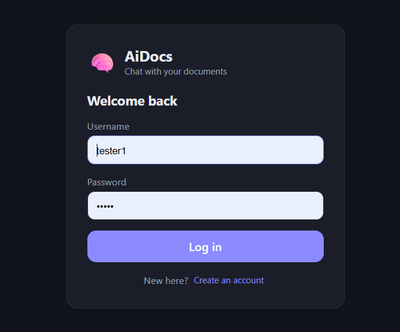
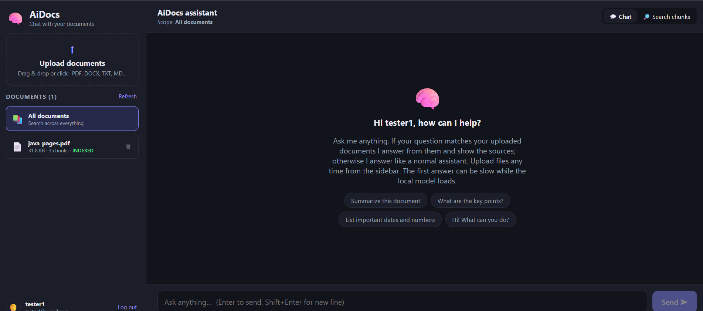

# AiDocs

**Chat with your own documents, privately and locally.**

AiDocs is a full-stack Retrieval-Augmented Generation (RAG) application. Users sign up, upload documents (PDF, Word, text and other formats), and ask questions in a streaming chat interface. Answers are grounded in the user's own documents and come with source citations (file name and page). Everything runs locally: the LLM and embeddings are served by [Ollama](https://ollama.com), and vectors are stored in PostgreSQL with pgvector. No data leaves your machine.

---

## Table of Contents

- [Features](#features)
- [Screenshots](#screenshots)
- [Tech Stack](#tech-stack)
- [Architecture](#architecture)
- [How the RAG Pipeline Works](#how-the-rag-pipeline-works)
- [Project Structure](#project-structure)
- [Getting Started](#getting-started)
- [Configuration](#configuration)
- [API Reference](#api-reference)
- [Frontend](#frontend)
- [Production Notes](#production-notes)
- [Limitations and Roadmap](#limitations-and-roadmap)
- [Contributing](#contributing)
- [License](#license)

---

## Features

- **Document-grounded Q&A.** Questions are answered from the user's uploaded documents, with citations that show the file name and page number.
- **Hybrid chat behaviour.** If nothing in the documents is relevant (greetings, maths, general knowledge), the model answers as a normal chatbot instead of forcing document text into the reply.
- **Streaming responses.** Answers stream token by token over Server-Sent Events (SSE).
- **Multi-format ingestion.** PDFs are parsed page by page (Spring AI PDF reader). Other formats go through Apache Tika.
- **Semantic chunk search.** A dedicated endpoint returns the most similar chunks for a query, with similarity scores.
- **Per-document or all-documents scope.** Chat against one selected document or across everything you have uploaded.
- **JWT authentication.** Sign-up and login, stateless sessions, and role-based access (`USER`, `ADMIN`).
- **Per-user isolation.** Every chunk is tagged with the owner's `userId`, and every vector search is filtered by it, so users never see each other's content.
- **Document lifecycle tracking.** Each document moves through `UPLOADING`, `PROCESSING`, `INDEXED` or `FAILED`.
- **Clean deletion.** Deleting a document also removes its vectors from the vector store.
- **Local-first.** Runs on Ollama (`llama3.2:3b` and `nomic-embed-text` by default). An OpenAI configuration is included, commented out, as an alternative.

---

## Screenshots

### Login / Sign up


### Chat with citations


---

## Tech Stack

| Layer | Technology |
|---|---|
| Backend | Java 21, Spring Boot 4.1.2, Spring MVC, Spring Security, Spring Data JPA |
| AI | Spring AI 2.0.1 (ChatClient, VectorStore, document readers) |
| LLM / Embeddings | Ollama: `llama3.2:3b` (chat), `nomic-embed-text` (768-dim embeddings) |
| Vector store | PostgreSQL 16 + pgvector (HNSW index, cosine distance) |
| Document parsing | Spring AI PDF reader, Apache Tika reader |
| Auth | JWT (jjwt 0.13.0), BCrypt password hashing |
| Mapping / boilerplate | ModelMapper, Lombok |
| Frontend | React 18, Vite 5 |
| Infrastructure | Docker Compose (Postgres + Ollama), Maven Wrapper |

---

## Architecture

```
┌──────────────────────┐      /api/*       ┌────────────────────────────┐
│  React + Vite (5173) │ ────────────────▶ │  Spring Boot API (8081)    │
│  Auth, upload, chat  │   (dev proxy)     │  Auth · Documents · Chat   │
└──────────────────────┘                   └──────┬──────────────┬──────┘
                                                  │              │
                                   JPA (metadata, │              │ Spring AI
                                   users)         ▼              ▼
                                       ┌─────────────────┐  ┌──────────────────┐
                                       │ PostgreSQL 16   │  │ Ollama (11434)   │
                                       │ + pgvector      │  │ llama3.2:3b      │
                                       │ (port 5434)     │  │ nomic-embed-text │
                                       └─────────────────┘  └──────────────────┘
```

The Spring Boot app talks to PostgreSQL for two things: relational data (users, document metadata) through JPA, and vectors (chunk embeddings) through Spring AI's `PgVectorStore`.

---

## How the RAG Pipeline Works

### Ingestion (upload)

1. The user uploads a file to `POST /api/v1/documents/upload`.
2. A `DocumentMetaData` row is saved with status `UPLOADING`.
3. `ParserService` reads the file. PDFs use `PagePdfDocumentReader` (one document per page). Everything else uses `TikaDocumentReader`.
4. `IngestService` sets the status to `PROCESSING` and splits the text into chunks with `TokenTextSplitter` (default chunk size 700 tokens).
5. Each chunk is enriched with metadata: `documentId`, `fileName`, `contentType`, `chunkIndex`, `userId` and `pageNumber`.
6. Chunks are embedded by Ollama (`nomic-embed-text`) and written to the `vector_store` table.
7. The status becomes `INDEXED` and `totalChunks` is stored. If parsing yields no text (for example a scanned, image-only PDF), the upload is rejected and the metadata row is removed.

### Retrieval and generation (chat)

1. The user's question is sent to `POST /api/v1/chat/stream`.
2. `RagService` runs a similarity search, always filtered by the caller's `userId` (and optionally by `documentId`).
3. The similarity threshold depends on scope:
   - A **single document is selected**: threshold `0`, so that document's best chunks are always used.
   - **All documents**: `app.rag.chat-similarity-threshold` is applied, so unrelated messages get no document context.
4. Matching chunks are formatted as `[Source: <file> | Page: <n>]` blocks and placed into the prompt.
5. The prompt tells the model to answer from the context when it is relevant, and otherwise to answer helpfully from general knowledge.
6. The reply is streamed back as SSE events: `{"token": "..."}` for each piece, then `{"done": true}`. On failure the stream emits `{"error": "...", "done": true}`.

---

## Project Structure

```
aidocs/
├── pom.xml                         # Maven build (Java 21, Spring Boot, Spring AI)
├── mvnw / mvnw.cmd                 # Maven wrapper
├── docker-compose.yml              # Postgres (pgvector) + Ollama
├── init.sql                        # Enables the `vector` and `uuid-ossp` extensions
├── src/
│   ├── main/
│   │   ├── java/com/aidocs/
│   │   │   ├── AidocsApplication.java
│   │   │   ├── configuration/      # Security, JWT filter, CORS, ChatClient, RAG properties
│   │   │   ├── controller/         # AuthController, DocumentController, ChatController
│   │   │   ├── dto/                # Request/response objects (ChatRequestDto, CitationDto, ...)
│   │   │   ├── entity/             # User, DocumentMetaData, Role, DocumentStatus
│   │   │   ├── exception/          # GlobalExceptionHandler and custom exceptions
│   │   │   ├── respostory/         # Spring Data JPA repositories
│   │   │   └── service/            # Parser, Ingest, Rag, Document, User, JWT services
│   │   └── resources/
│   │       ├── application.properties       # Activates the `dev` profile, port 8081
│   │       └── application-dev.properties   # DB, Ollama, pgvector and RAG settings
│   └── test/java/com/aidocs/       # Context-load test
└── aidocs-frontend/                # React + Vite single-page app
    ├── .env.example
    ├── vite.config.js              # Dev proxy: /api -> http://localhost:8081
    └── src/
        ├── App.jsx
        ├── api.js                  # All backend calls, JWT/session handling
        ├── main.jsx
        ├── styles.css
        └── components/
            ├── AuthPage.jsx        # Login / sign-up
            ├── Sidebar.jsx         # Document list, upload, delete, select
            ├── ChatPanel.jsx       # Streaming chat and search mode
            └── Message.jsx         # Message bubble and citations
```

---

## Getting Started

### Prerequisites

- **Java 21**
- **Node.js 18+** and npm
- **Docker** and Docker Compose
- Enough RAM and disk for a small local LLM (`llama3.2:3b` needs roughly 2 GB for the model)

### 1. Clone the repository

```bash
git clone https://github.com/adarsh25tiwari/aidocs.git
cd aidocs
```

### 2. Start PostgreSQL (pgvector) and Ollama

```bash
docker compose up -d
```

This starts:

| Service | Container | Host port |
|---|---|---|
| PostgreSQL 16 + pgvector | `aidocs-postgres` | `5434` |
| Ollama | `aidocs-ollama` | `11434` |

`init.sql` runs automatically on first start and enables the `vector` and `uuid-ossp` extensions.

### 3. Pull the Ollama models

```bash
docker exec -it aidocs-ollama ollama pull llama3.2:3b
docker exec -it aidocs-ollama ollama pull nomic-embed-text
```

### 4. Run the backend

```bash
./mvnw spring-boot:run          # macOS / Linux
mvnw.cmd spring-boot:run        # Windows
```

The API starts on **http://localhost:8081**. Hibernate creates the tables on first run (`ddl-auto=update`), and Spring AI creates the `vector_store` table and HNSW index (`initialize-schema=true`).

### 5. Run the frontend

```bash
cd aidocs-frontend
cp .env.example .env            # leave VITE_API_BASE empty in dev
npm install
npm run dev
```

Open **http://localhost:5173**, create an account, upload a document and start chatting.

### Production build (frontend)

```bash
npm run build      # outputs to aidocs-frontend/dist
npm run preview
```

For a deployed build served from another origin, set `VITE_API_BASE` (for example `http://localhost:8081`) and add that origin to `app.cors.allowed-origins`.

---

## Configuration

Settings live in `src/main/resources/application-dev.properties`.

### Database

| Property | Default | Env override |
|---|---|---|
| `spring.datasource.url` | `jdbc:postgresql://localhost:5434/aidocs` | `DB_HOST`, `DB_PORT`, `DB_NAME` |
| `spring.datasource.username` | `postgres` | `DB_USER` |
| `spring.datasource.password` | `postgres` | `DB_PASSWORD` |

### AI models

| Property | Default |
|---|---|
| `spring.ai.ollama.base-url` | `http://localhost:11434` |
| `spring.ai.ollama.chat.options.model` | `llama3.2:3b` |
| `spring.ai.ollama.chat.options.temperature` | `0.2` |
| `spring.ai.ollama.embedding.options.model` | `nomic-embed-text` |
| `spring.ai.vectorstore.pgvector.dimensions` | `768` |
| `spring.ai.vectorstore.pgvector.index-type` | `HNSW` |
| `spring.ai.vectorstore.pgvector.distance-type` | `COSINE_DISTANCE` |

To use OpenAI instead, uncomment the OpenAI block, add the OpenAI starter dependency in place of the Ollama one, and set `dimensions=1536` to match `text-embedding-3-small`. If you change the embedding model, re-ingest your documents, because vector sizes must match.

### RAG tuning (`app.rag.*`)

| Property | Default | Meaning |
|---|---|---|
| `chunk-size` | `700` | Target tokens per chunk |
| `top-k` | `5` | Chunks retrieved per query |
| `similarity-threshold` | `0.0` | Default threshold for the search endpoint |
| `chat-similarity-threshold` | `0.55` | Minimum score for chunks to be used in chat when no document is selected |

### Uploads and CORS

| Property | Default |
|---|---|
| `spring.servlet.multipart.max-file-size` | `25MB` |
| `spring.servlet.multipart.max-request-size` | `50MB` |
| `app.cors.allowed-origins` | `*` |

### Authentication

| Property | Default | Env override |
|---|---|---|
| `jwt.secret` | built-in dev value | `JWT_SECRET` |
| `jwt.expiration` | `3600000` (1 hour) | n/a |

---

## API Reference

Base URL: `http://localhost:8081`. All endpoints except `/api/v1/auth/**` require the header `Authorization: Bearer <token>`.

### Auth

| Method | Endpoint | Body | Description |
|---|---|---|---|
| `POST` | `/api/v1/auth/signup` | `{ username, email, password }` | Create a `USER` account. Returns the user (`201`). |
| `POST` | `/api/v1/auth/login` | `{ username, password }` | Returns a JWT and the user object. |

### Documents

| Method | Endpoint | Description |
|---|---|---|
| `POST` | `/api/v1/documents/upload` | Upload one file (`multipart/form-data`, field `file`). |
| `POST` | `/api/v1/documents/upload-multiple` | Upload several files (field `files`). |
| `GET` | `/api/v1/documents/user` | List the logged-in user's documents, newest first. |
| `GET` | `/api/v1/documents` | List all documents. **ADMIN only.** |
| `GET` | `/api/v1/documents/{id}` | Get one document's metadata (owner or admin). |
| `DELETE` | `/api/v1/documents/{id}` | Delete a document and its vectors (owner or admin). |

Non-owners get a `404` rather than a `403`, so document IDs are not revealed.

### Chat

| Method | Endpoint | Description |
|---|---|---|
| `POST` | `/api/v1/chat/stream` | Streaming answer over SSE. |
| `POST` | `/api/v1/chat/query` | Non-streaming answer with citations and response time. |
| `POST` | `/api/v1/chat/search/similarity` | Return the most similar chunks for a query. |

**Chat request** (`/stream`, `/query`):

```json
{
  "question": "What is the budget?",
  "documentId": "optional-uuid",
  "topK": 5,
  "minSimilarity": 0.55,
  "conversationId": "optional-uuid"
}
```

**Similarity search request:**

```json
{
  "query": "Who is the programme lead?",
  "topK": 3,
  "documentId": "optional-uuid",
  "similaritySearch": 0.0
}
```

### Example with curl

```bash
# Sign up and log in
curl -X POST http://localhost:8081/api/v1/auth/signup \
  -H "Content-Type: application/json" \
  -d '{"username":"alice","email":"alice@example.com","password":"secret123"}'

TOKEN=$(curl -s -X POST http://localhost:8081/api/v1/auth/login \
  -H "Content-Type: application/json" \
  -d '{"username":"alice","password":"secret123"}' | jq -r '.token')

# Upload a document
curl -X POST http://localhost:8081/api/v1/documents/upload \
  -H "Authorization: Bearer $TOKEN" \
  -F "file=@./report.pdf"

# Ask a question (streaming)
curl -N -X POST http://localhost:8081/api/v1/chat/stream \
  -H "Authorization: Bearer $TOKEN" \
  -H "Content-Type: application/json" \
  -d '{"question":"Summarise the report"}'
```

---

## Frontend

A small React + Vite single-page app with:

- A login and sign-up screen. The JWT and user are stored in `localStorage`, and the app returns to the login screen on a `401`.
- A sidebar to upload, list, select and delete documents.
- A chat panel with streaming answers and source citations.
- A "search chunks" mode backed by the similarity endpoint.

In development, `vite.config.js` proxies `/api/*` to `http://localhost:8081`, so the browser never makes a cross-origin request and no CORS setup is needed.

---

## Production Notes

- Set `JWT_SECRET` to a long, random value.
- Restrict `app.cors.allowed-origins` to your frontend origin.
- Change the default database password and serve the app over HTTPS.
- Replace `ddl-auto=update` with proper migrations (for example Flyway).

---

## Limitations and Roadmap

- Scanned or image-only PDFs are not supported (no OCR step yet).
- Chat history is not persisted; each request is independent.
- Documents are processed synchronously during upload.
- The backend is not yet part of `docker-compose.yml`.

Planned: conversation memory, OCR support, an admin dashboard, additional LLM providers and a model switcher in the UI.

---

## Contributing

1. Fork the repository.
2. Create a feature branch: `git checkout -b feature/my-feature`.
3. Commit your changes and push the branch.
4. Open a pull request describing what you changed and why.

---

## License

Licensed under the [MIT License](https://github.com/adarsh25tiwari/aidocs/blob/main/LICENSE).
